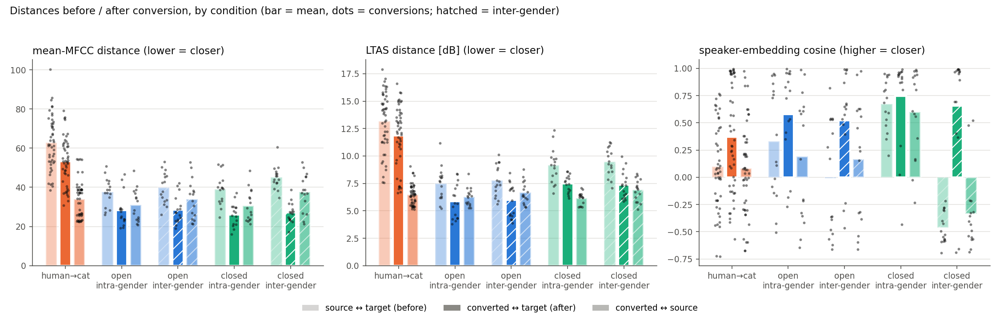
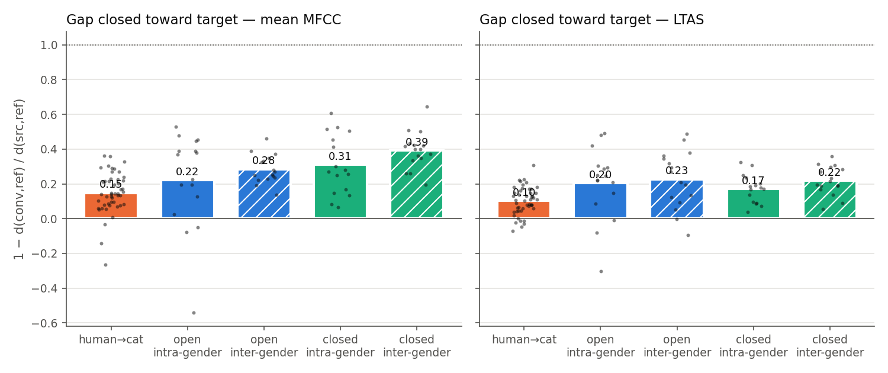
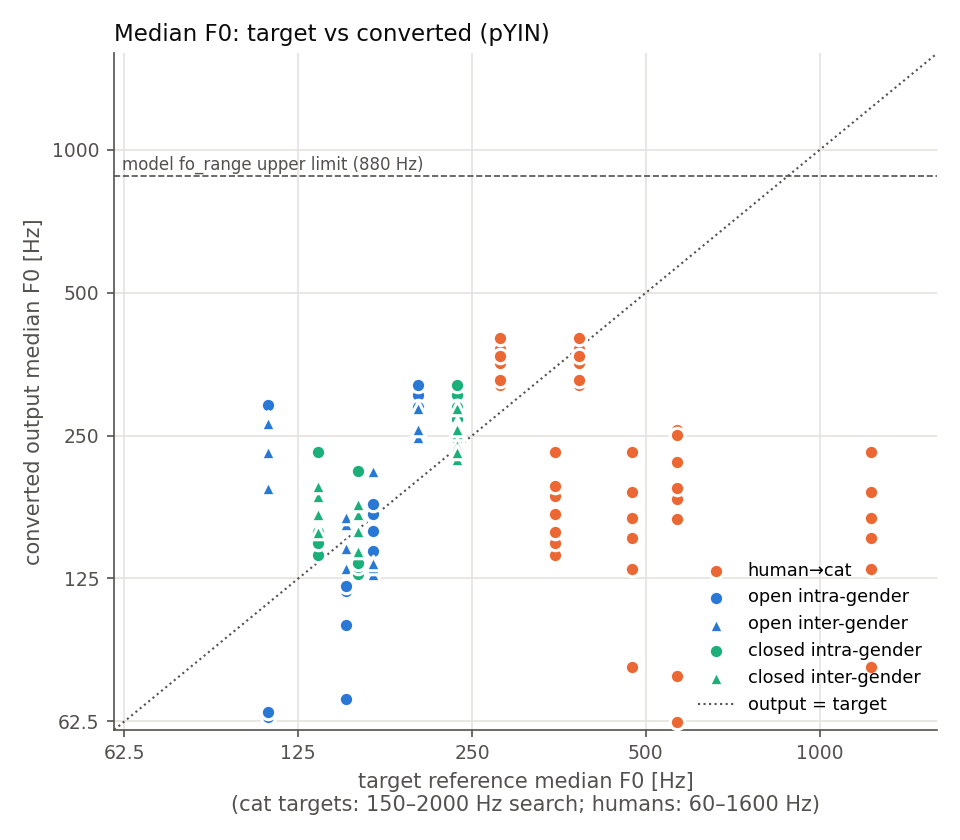
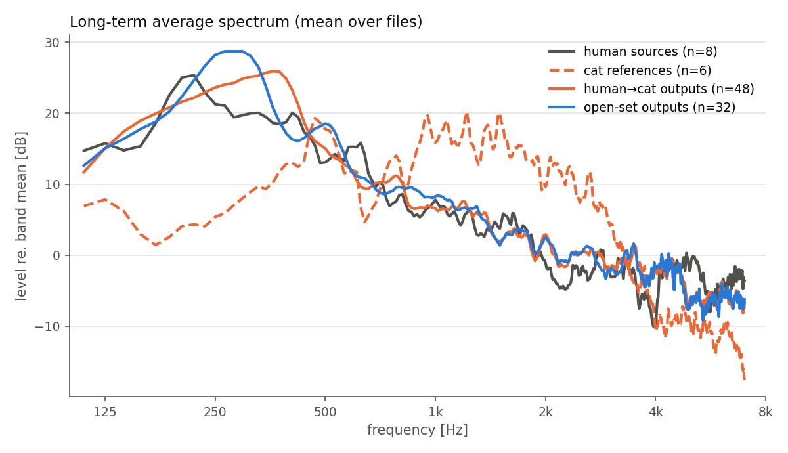
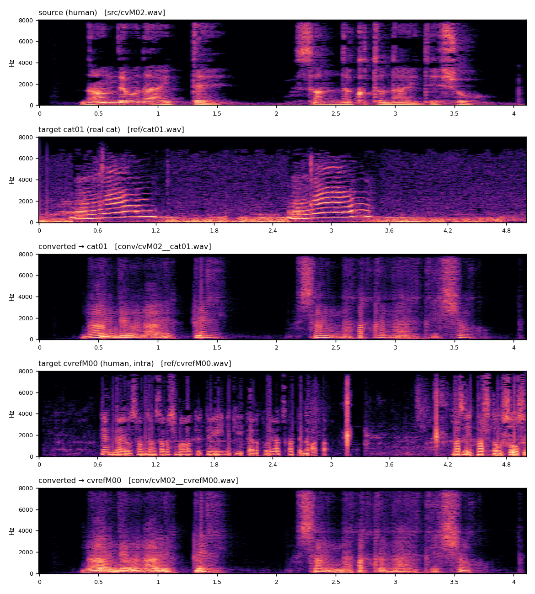

# 01. End-to-end feasibility test

## Objective

Check that the pretrained NVCNSF model (`/path/to/checkpoints/`, step 500000) can run
human → cat conversion end to end, and measure how close the generated "cat-like" sounds get to the target cat
acoustically. The comparison point is conventional human → human VC with the same model and the same sources:

| condition | target reference | why it is a reference point |
|---|---|---|
| `human2cat` | real cat vocalization (meow-10k) | the condition under study |
| `open_intra` / `open_inter` | unseen Common Voice speaker, same / other gender | open-set VC, the realistic deployment case (cats are open-set too) |
| `closed_intra` / `closed_inter` | jvs training speaker, same / other gender | closed-set VC, upper bound of what the model does well |

Concrete questions:
1. Does the pipeline produce valid, finite audio for cat references? (feasibility)
2. How much of the source→target acoustic distance does a conversion close, and how does human→cat compare with
   the conventional settings?
3. Does the output pitch follow the target into the cat F0 range?

## Data

| role | source | selection (seed 0) |
|---|---|---|
| sources | Common Voice ja `test.tsv` | 4 male + 4 female speakers (`gender` labeled), one 3–7 s utterance each |
| open-set refs | Common Voice ja `test.tsv` | 2 M + 2 F speakers disjoint from the sources; up to 6 clips concatenated (≥ 4 s after silence removal) |
| closed-set refs | jvs `nonpara30` | jvs001 (M), jvs003 (M), jvs002 (F), jvs004 (F); 3 utterances concatenated |
| cat refs | meow-10k `audios/` (16 kHz) | 120 random clips screened with pYIN (150–2000 Hz); top 6 by voiced ratio with median F0 in 250–1500 Hz |

The cat screening step exists because many meow-10k clips are behaviour recordings, not vocalizations. A first
ranking by voiced ratio alone picked clips whose "F0" was pinned at the search floor (purrs / low-frequency
background noise detected as voiced). The 250–1500 Hz median-F0 window removes those. Screening results:
`data/cat_candidates.csv`.

Selected cats: `cat00` fs_cat_class_00319, `cat01` tz_cat_class_00415, `cat02` fs_cat_class_00201,
`cat03` tz_cat_class_00419, `cat04` tz_cat_class_00204, `cat05` fs_cat_class_00705.

Total: 8 sources × 14 references = **112 conversions** (48 human→cat, 16 per baseline condition).

## Method

`generate.py` follows the `infer.py` pipeline (speaker_encode → content_encode → condition → synth, block-wise over
`sample_length`) through the wrapper in `vc.py`. References are silence-trimmed as in `infer.py` and tiled /
center-cropped to 2 × `sample_length` (2.73 s). The quantized speaker code `z_q` drives the conversion.

`analyze.py` computes, on 16 kHz versions of every file (common bandwidth: the cat recordings are 16 kHz):

| metric | definition |
|---|---|
| `mfcc` | Euclidean distance of utterance-mean MFCC c1–c24 over non-silent frames (librosa units) |
| `ltas` | RMS difference (dB) of level-normalized long-term average spectra, 100 Hz–7 kHz |
| `spk` | cosine similarity of the model's own continuous speaker embedding `z` |
| `f0` | pYIN median F0 of voiced frames (60–1600 Hz); cat targets use the 150–2000 Hz estimate (see limitations) |
| `gap_closed` | `1 − d(conv, ref) / d(src, ref)`: 1 = reached the target, 0 = did not move, < 0 = moved away |

To give the distances a scale, `reference_spread.csv` contains the distances among the real references
themselves (cat–cat, human–human, cat–human).

## Results

Means over conversions (`results/summary.csv` has ± std, `results/metrics.csv` has every conversion):

| condition | MFCC d(src,ref) | MFCC d(conv,ref) | MFCC gap closed | LTAS gap closed | spk cos (conv,ref) | target F0 [Hz] | output F0 [Hz] | \|F0 error\| [st] |
|---|---|---|---|---|---|---|---|---|
| **human→cat** | 62.8 | 53.2 | **0.15** | **0.10** | 0.37 | 546 | 228 | **15.9** |
| open intra | 37.6 | 28.4 | 0.22 | 0.20 | 0.58 | 158 | 169 | 6.5 |
| open inter | 39.9 | 28.6 | 0.28 | 0.23 | 0.52 | 158 | 202 | 5.9 |
| closed intra | 38.9 | 26.1 | 0.31 | 0.17 | 0.75 | 191 | 218 | 3.2 |
| closed inter | 45.1 | 27.2 | 0.39 | 0.22 | 0.66 | 191 | 210 | 2.2 |

Spread among the real references (mean pairwise MFCC distance): cat–cat 58.3, cat–human 55.3, human–human 33.0.

### Figures

Before/after distances per condition:



Fraction of the acoustic gap closed:



Target vs. output median F0:



Average spectra of sources, cat references, and outputs:



Source, best human→cat output, cat target, and open intra-gender output:



### Findings

1. **The pipeline runs end to end.** All 112 conversions finished with finite output and the expected length,
   so subexperiments 2–4 can use these scripts as their base.
2. **Human→cat moves toward the target less than any conventional setting.** It closes 15 % of the MFCC gap
   (vs 22–39 % for the baselines) and 10 % of the LTAS gap (vs 17–23 %). The starting gap is also much larger (62.8
   vs 38–45). After conversion the output is still 53.2 from its cat target, which is about the cat–human
   spread (55.3) and nowhere near the 26–29 reached by the human→human conditions. **Acoustically, the outputs are
   still human voices.**
3. **Pitch does not reach the cat range.** Target cat F0 is 280–1230 Hz (mean 546 Hz), while output F0 stays at
   65–400 Hz (mean 228 Hz), an error of ≈ 16 semitones (vs 2–7 st for the baselines). The output F0 depends on the
   target code (median 146–327 Hz per cat) but never exceeds ~400 Hz. One cause is structural: the model's
   `fo_range` is 27.5–880 Hz, so cat00 (≈ 1.2 kHz) cannot be represented at all.
4. **The spectrograms agree:** the human→cat output keeps the source's phonetic structure and harmonic spacing,
   with no sustained high-F0 harmonic pattern like the cat's (`spectrogram_examples.png`). The output LTAS follows
   the human sources and lacks the cat's 0.8–3 kHz energy bump (`ltas.png`).
5. **The model's speaker embedding treats outputs as "cat-like" more than acoustic metrics do.** Cosine to the cat
   target rises from 0.10 to 0.37, above the mean cat–cat similarity (0.33). Because the encoder that judges the
   output is the one that conditioned it, this measure is optimistic and is not taken as evidence of cat-likeness.
   Subexperiment 2 tests this with an independent classifier.

**Compared with conventional VC:** the closed-set inter-gender condition (a large but in-domain timbre/pitch
change) closes 39 % of the MFCC gap with a 2 st F0 error, while human→cat closes 15 % with a 16 st error. The
species gap is not just a larger version of the gender gap. It falls outside the model's training distribution
(jvs speech) and its pitch range. Open-set human conversion is also worse than closed-set (0.22–0.28 vs
0.31–0.39), so part of the human→cat shortfall is the open-set effect. The rest is specific to the species domain.

## Limitations

- Small sample (8 sources, 6 cats), single seed. This is a feasibility check, not a statistical comparison; no
  significance tests are reported.
- Cat clips are 16 kHz field recordings with background noise. For one cat (cat05), the wide-range pYIN locks onto
  low-frequency background at 157 Hz (vs 280 Hz in the 150–2000 Hz band). This is why cat target F0 uses the
  meow-band estimate. Both values are kept in `metrics.csv` (`f0_ref`, `f0_ref_meow`).
- Cat clips can mix meows with other sounds (purr, noise), and the 2.73 s reference crop may include them.
- Utterance-mean MFCC and LTAS ignore temporal structure (a cat call's pitch contour, duration), which
  subexperiment 3 covers.
- The speaker-embedding cosine is noisy (human–human spread ≈ 0.06, values spanning −0.7 to 1). Its gap ratio is
  unstable, so it is reported only as a raw similarity.

## Files

| file | content |
|---|---|
| `vc.py` | model wrapper (follows `infer.py`), audio loading, silence trimming |
| `generate.py` | data selection, cat screening, conversion → `data/` |
| `analyze.py` | metrics, summaries, plots → `results/` |
| `data/manifest.csv` | one row per conversion (paths, condition, speakers) |
| `data/{src,ref,conv}/*.wav` | audio (24 kHz); `data/conv_fo/*.npy`: model F0 at 100 frames/s |
| `results/metrics.csv`, `summary.{csv,json}`, `reference_spread.csv` | numeric results |
| `generate.log`, `analyze.log` | logs of the last run |

## Reproduce

```bash
conda activate nvcnsf
cd experiment_01_cat_01/01.end_to_end_feasibility
python generate.py   # ~3 min (cat screening + 112 conversions on GPU)
python analyze.py    # ~5 min
```

Options: `generate.py --n-src-per-gender 4 --n-ref-per-gender 2 --n-cat 6 --n-cat-pool 120 --seed 0`.
Note: `vc.py` imports TensorFlow (with its GPU hidden) before JAX, in the same order as `infer.py`. Importing
`preprocesses` after JAX has started causes a segfault.
