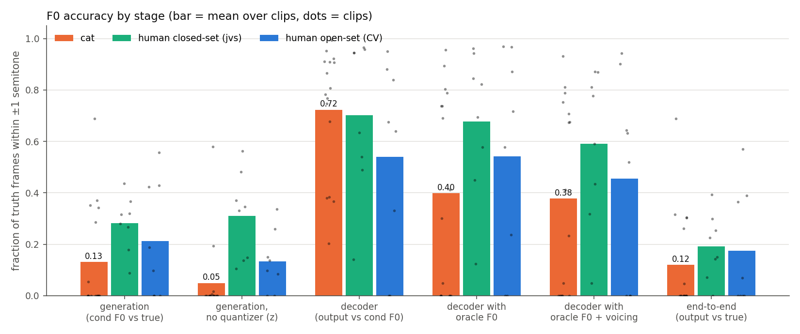
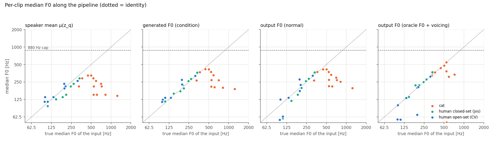
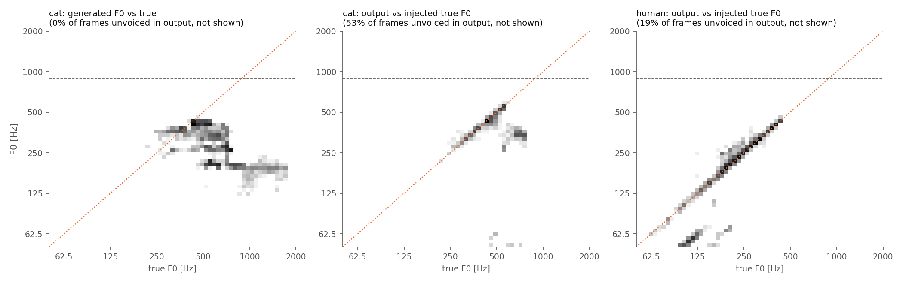
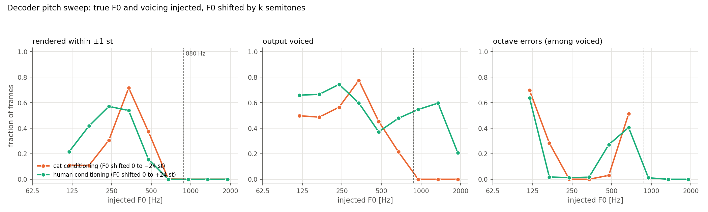
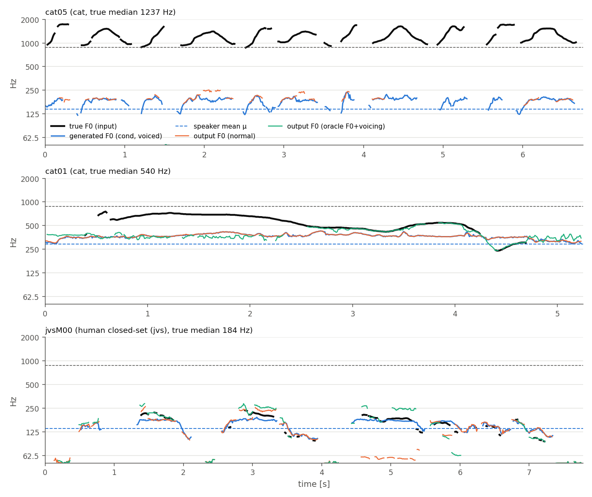

# 03. Acoustic similarity analysis: where is cat F0 lost?

## Objective

Subexperiment 01 found that human→cat outputs keep a human pitch: about 228 Hz against cat targets of about 546 Hz,
an error of about 16 semitones. This subexperiment finds **which stage loses the cat F0**:

- **F0 generation** (`Condition`): the model predicts
  `fo = 10 · 2^((μ(z) + σ(z) · s(c)) / 12)`, clipped to 27.5–880 Hz. The speaker code `z` sets the mean μ and the
  spread σ. The content features `c` set the normalized contour `s` (bounded to ±3 by tanh).
- **Decoder** (`synth`): a cyclic-noise source driven by `fo`, followed by neural filters conditioned on the
  same features.

It also compares voicing, aperiodicity (decay rate β, spectral flatness) and the speaker-code quantization of
real cats against real humans.

## Method

### Self-reconstruction design

Every clip is reconstructed with **its own** speaker code. Input and output are then time-aligned, so the input's
pYIN F0 serves as frame-level ground truth for every stage. Four settings per clip (`generate.py`):

| setting | speaker code | F0 / voicing given to the decoder | isolates |
|---|---|---|---|
| `zq` | `z_q` (normal) | model | normal operation |
| `z` | continuous `z` | model | effect of the 512-code quantizer |
| `oracle_fo` | `z_q` | **true F0**; model voicing | decoder alone |
| `oracle_fo_vf` | `z_q` | **true F0 and true voicing** | decoder alone |

**Supplemental pitch sweep** (`generate_sweep.py`). The oracle runs inject cat F0 under cat conditioning, so a
decoder failure could come from the frequency or from the cat code. To separate these, each clip is re-synthesized
with its true F0 and voicing, but F0 shifted by k semitones: humans by k = 0…+24 (into the cat range) and cats by
k = 0…−24 (into the human range). If accuracy depends only on the injected frequency, both groups fall on one
curve.

### Data

| group | n | source |
|---|---|---|
| cat | 16 | meow-10k, screened from 300 random clips as in subexp 01 (top pYIN voiced ratio, median F0 250–1500 Hz); silence-trimmed, ≤ 8 s |
| human closed-set | 8 (4 M, 4 F) | jvs005, 006, 009, 011 (M) and jvs007, 008, 010, 014 (F), `VOICEACTRESS100_001` (training speakers; disjoint from the subexp-01 references) |
| human open-set | 8 (4 M, 4 F) | Common Voice ja test, the same 8 sources as subexp 01 |

### Processing and measures

- The model runs block-wise **with the streaming state carried across blocks**, as in `infer.py`. Subexp 01
  restarted the state each block, and a single whole-utterance call needs more than 11 GB of GPU memory.
- Ground truth comes from pYIN (50–2000 Hz, 10 ms hop). "Truth frames" are frames where pYIN says voiced with
  probability > 0.5; for cats the F0 must also be ≥ 200 Hz, which removes background noise (see subexp 01).
- Output F0 uses pYIN's voiced decision. Outputs are shifted back by the decoder latency, estimated per clip
  (0–5 frames, mean 1.6–2.5 frames).
- **Accuracy** is the fraction of truth frames whose pitch is within ±1 semitone. An unvoiced output frame counts as
  wrong (the pitch was not rendered). Octave errors are reported separately.

## Results

### 1. Accuracy per stage (means over clips; `results/summary.csv`, `stage_accuracy.png`)

| stage | cat | human closed | human open |
|---|---|---|---|
| generation: condition F0 vs true F0 | **0.13** | 0.28 | 0.21 |
| generation without quantizer (`z`) | **0.05** | 0.31 | 0.13 |
| decoder: output vs condition F0 | 0.72 | 0.70 | 0.54 |
| decoder with oracle F0 + voicing | **0.38** | 0.59 | 0.46 |
| end to end: output vs true F0 | 0.12 | 0.19 | 0.17 |

In normal operation, the decoder renders the F0 it is given just as well for cats as for humans (0.72; median bias
+0.3 st, no octave errors). **The cat pitch is already wrong when it leaves the generation stage, and the decoder
faithfully renders that wrong pitch.** Given the correct cat F0, however, the decoder renders only 0.38 of it.

### 2. Why generation fails (`f0_along_pipeline.png`, `contour_examples.png`)

| component | cat | human closed | human open |
|---|---|---|---|
| true median F0 [Hz] | 572 | 228 | 168 |
| speaker mean μ(z_q) [Hz] | 243 | 191 | 175 |
| mean offset: μ − true [st] | **−14.5** | −3.2 | +1.2 |
| contour r (predicted vs true st) | **0.04** | 0.86 | 0.60 |
| range ratio (std predicted / std true) | 0.89 | 0.52 | 1.04 |
| frames clipped at 880 Hz | 0 | 0 | 0 |
| voicing (vf > 0.5) on truth frames | 0.99 | 0.98 | 0.97 |

- **The speaker mean μ is the main error (−14.5 st).** For cats, μ stays at 144–323 Hz whatever the true F0
  (325–1237 Hz). For humans it follows the true F0 (left panel of `f0_along_pipeline.png`).
- **The quantizer is not the cause.** Continuous `z` gives the same μ (235 Hz, offset −14.9 st). The cat
  embeddings are out of distribution (distance from `z` to the nearest code: 3.7 vs 2.0–2.3 for humans), yet 11 of
  16 cats are mapped to codes that human speakers also use (218, 280, 306, 322, 323). The μ head never outputs a
  cat-like mean, with or without the quantizer.
- **The contour also fails.** Predicted and true pitch movements are uncorrelated for cats (r = 0.04, vs 0.86 for
  jvs). The contour s comes only from the content encoder, which explains why r is identical for `z` and `z_q` (μ
  and σ only shift and scale it). A cat's pitch glide is not carried by the content features.
- The 880 Hz clip is **not** the active limit (0 % of frames clipped), because the generated F0 never gets near
  it. Cat truth frames above 880 Hz (7 % per clip on average, 9.6 % of pooled frames) would be clipped even with a
  perfect μ.
- Voicing is fine: the model marks 99 % of cat voiced frames as voiced.

### 3. Why the decoder fails on correct cat F0 (`oracle_by_f0_band.csv`, `decoder_pitch_sweep.png`, `frame_f0_histograms.png`)

Oracle F0 + voicing, cat frames by true F0:

| true F0 | frames | rendered within ±1 st | output voiced | correct when voiced |
|---|---|---|---|---|
| 200–440 Hz | 1096 | **0.93** | 0.96 | 0.97 |
| 440–880 Hz | 4284 | 0.22 | 0.41 | 0.54 (21 % octave errors) |
| 880–2000 Hz | 569 | **0.00** | 0.00 | — |

Pitch sweep, accuracy among voiced output frames, by injected F0 band:

| injected F0 | cat conditioning | human conditioning |
|---|---|---|
| 283–400 Hz | 0.92 | 0.90 |
| 400–566 Hz | 0.82 | 0.42 |
| 566–800 Hz | **0.01** | **0.00** |
| 800–1131 Hz | output never voiced | voiced, 0.00 correct |
| 1131–1600 Hz | output never voiced | voiced, 0.00 correct |

- **The decoder has a pitch ceiling around 550 Hz, and it does not depend on cat conditioning.** Human
  conditioning pushed upward fails in the same band as cat conditioning (0.00 vs 0.01 at 566–800 Hz), while cat
  conditioning pulled down into 283–566 Hz renders correctly (0.82–0.92). So the failure is about the frequency, not
  the cat timbre or content.
- Above the ceiling the decoder does not simply clip. Between 550 and 880 Hz the output collapses to an unrelated
  pitch around 330–400 Hz (e.g. cat01 in `contour_examples.png`). Above 880 Hz, cat-conditioned output contains no
  voiced pitch at all.
- The ceiling matches the training data: jvs per-speaker maximum F0 is ≤ 480 Hz (female median 410 Hz,
  `gender_f0range.txt`).
- There is also a lower limit: below about 140 Hz, 64–70 % of voiced frames are rendered an octave too low, in both
  groups. This is a separate problem that already affects human male voices (e.g. jvsM01: condition 113 Hz, output
  58 Hz).

### 4. Aperiodicity

| | cat | human closed | human open |
|---|---|---|---|
| model decay rate β (median) | 0.254 | 0.257 | 0.259 |
| log10 spectral flatness, input (voiced frames) | −10.7 | −9.0 | −9.9 |
| log10 spectral flatness, reconstruction `zq` | −7.6 | −8.6 | −8.6 |
| log10 spectral flatness, reconstruction oracle | −6.6 | −8.4 | −8.3 |

- β barely changes from speaker to speaker (0.254–0.259), so the β head does not tell cats from humans.
- Real cat calls are more tonal than human speech (flatness −10.7 vs −9.0/−9.9). Reconstructions of cats are noisier
  than humans' (−7.6 vs −8.6): the cat's tonality is not reproduced either. It gets worse with oracle F0, because
  high-F0 frames come out unvoiced (noise).

### Figures

Accuracy at each pitch-processing stage:



F0 through the model pipeline:



Frame-level F0 distributions:



Decoder accuracy across the pitch sweep:



Examples of pitch contours through the pipeline:



### Conclusion

**Both stages are at fault, in a chain:**

1. **F0 generation fails first, and in normal use it is the step that produces the error.** The speaker head
   maps every cat to a human-range mean F0 (−14.5 st), and the content encoder does not carry the cat's pitch
   contour (r = 0.04). This happens with or without quantization, so it is a property of the trained μ/σ heads and
   content features, not of the codebook alone.
2. **The decoder fails as well.** Even with perfect F0, it cannot render pitch above about 550 Hz. This is a
   frequency limit, independent of the cat code, and consistent with a training range of ≤ 480 Hz. About 80 % of cat
   voiced frames (440–2000 Hz) lie above it.
3. The 880 Hz `fo_range` clip is a third, currently hidden limit. It would cut about 7–10 % of cat frames once the
   first two are fixed.

Fixing only the F0 generation (e.g. supplying the cat's F0) would therefore bring end-to-end accuracy only to about
the oracle level (0.38). The decoder also has to be trained on, or augmented with, F0 up to about 1.5 kHz.

**Compared with conventional VC:** for human speakers, closed-set (jvs) generation has a small mean offset
(−3.2 st) and a good contour (r = 0.86). Open-set (CV) speakers have a good mean (+1.2 st) and a weaker contour
(r = 0.60). The cat condition is not just "more open-set": both its mean (−14.5 st) and its contour (0.04) fall
far outside both baselines, and its F0 range is outside what the decoder can render, which no human condition
reaches.

## Limitations

- 16 cats and 16 humans with one seed. Frame counts are pooled in the band tables, so clips with more voiced frames
  weigh more.
- Ground-truth F0 for noisy cat field recordings comes from pYIN with a 200 Hz floor; residual tracking errors
  remain.
- Absolute human accuracies are modest. Part of this is the decoder's low-F0 octave errors and the strict ±1 st
  criterion. The cat vs human comparisons are made under identical criteria.
- The training data is built offline from jvs as 15 identities × 11 pitch variants per speaker
  (`dataset_builders.py`). The pitch-shift range of that augmentation is not recorded in this repository. The
  ≤ 480 Hz figure is for the original jvs speakers, and the empirical decoder ceiling (~550 Hz) suggests the
  augmentation does not reach far beyond it. **This should be verified.**
- Spectral features beyond F0, voicing and flatness (formants, LTAS) were covered in subexp 01 and are not
  repeated here.

## Files

| file | content |
|---|---|
| `model.py` | stage-wise model access (content → condition → synth, streaming state, cond replacement) |
| `generate.py` | clip selection, ground-truth F0, the 4 settings → `data/` |
| `generate_sweep.py` | supplemental decoder pitch sweep → `data/sweep/` |
| `analyze.py` | stage metrics, F0 bands, sweep, plots → `results/` |
| `data/manifest.csv` | clips with speaker code, `z`→`z_q` distance |
| `data/frames/*.npz` | 10 ms ground truth and condition parameters (fo, vf, μ, σ, s, β, α) |
| `results/clip_metrics.csv`, `summary.{csv,json}`, `oracle_by_f0_band.csv`, `sweep_by_f0_band.csv` | numeric results |
| `results/stage_accuracy.png`, `f0_along_pipeline.png`, `frame_f0_histograms.png`, `decoder_pitch_sweep.png`, `contour_examples.png` | figures |

## Reproduce

```bash
conda activate nvcnsf
cd experiment_01_cat_01/03.acoustic_similarity_f0_stage
python generate.py         # ~12 min: cat screening (300 clips) + 128 reconstructions
python generate_sweep.py   # ~8 min: 160 sweep syntheses
python analyze.py          # ~10 min
```
